# Operaciones básicas OpenCV 
## Alumno: Alonso Lopez Garcia NC = 0087
## OpenCV
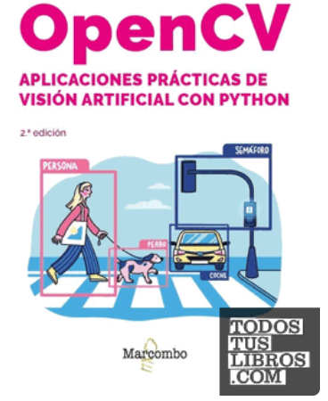

## 1. LECTURA DE LA IMAGEN DESDE LA CARPETA
#### Cuando no puede leer la imagen 
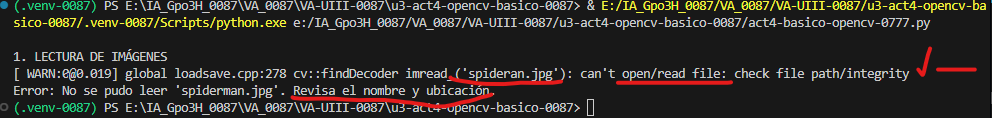

#### Cuando puede leer la imagen
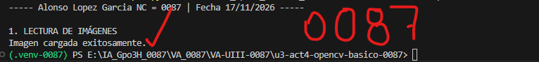
## 2. PROPIEDADES DE LA IMAGEN
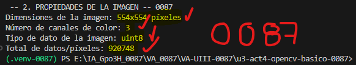

## 3. VISUALIZACIÓN DE LA IMAGEN ORIGINAL 
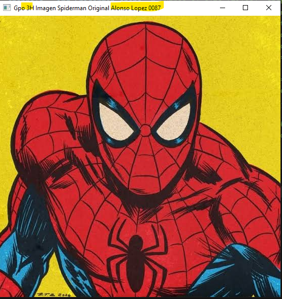

## En la terminal 
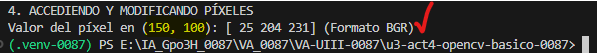

## 4. ACCESO Y MODIFICACIÓN DE PÍXELES INDIVIDUALES
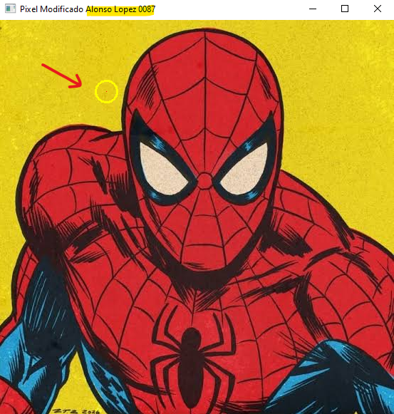

## 5. REGIÓN DE INTERÉS (ROI - REGION OF INTEREST)
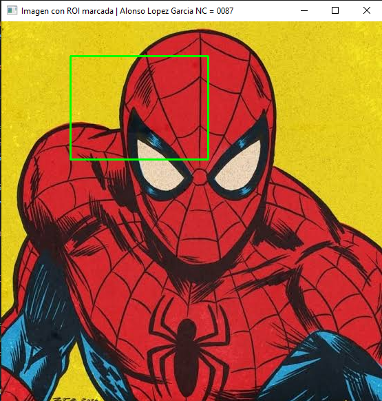

## 6. SEPARACIÓN Y FUSIÓN DE CANALES DE COLOR (BGR)
### Escala de grises 
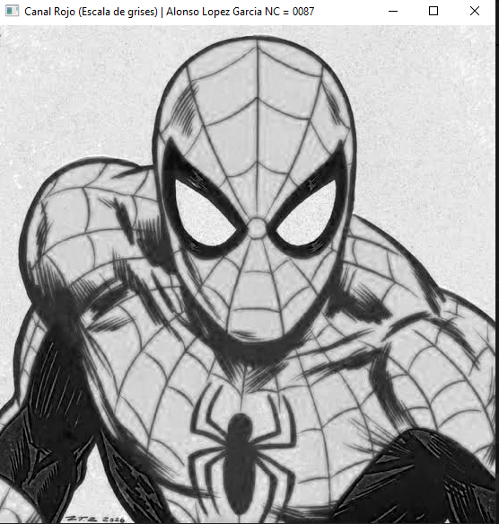
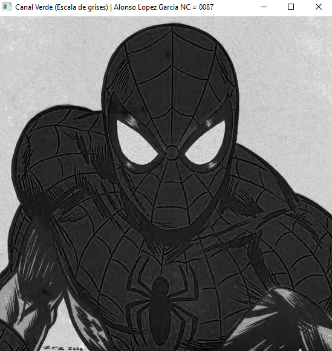
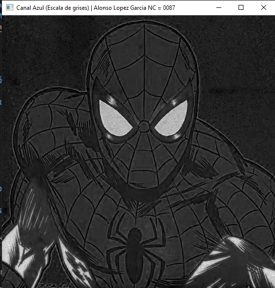
### Matriz llena de ceros 
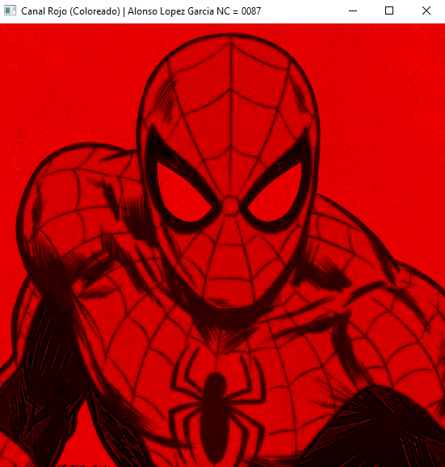
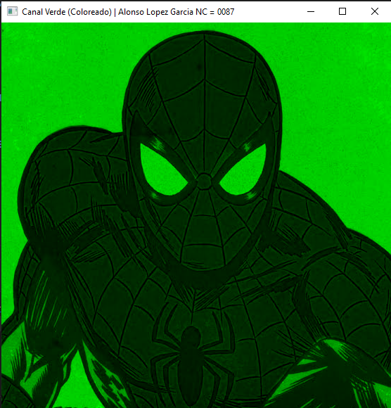
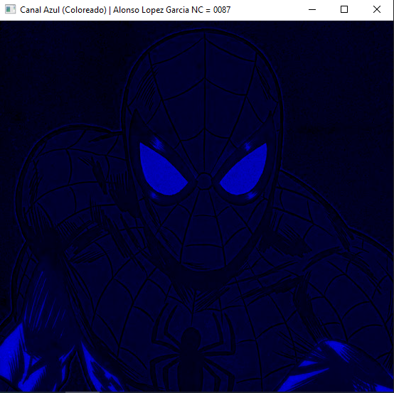

## 7. REDIMENSIONAMIENTO DE IMÁGENES (RESIZING)
### Redimensionada 400 x 300
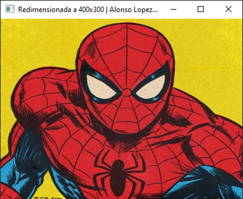
### Mitad de tamaño

### Ampliada x1.5
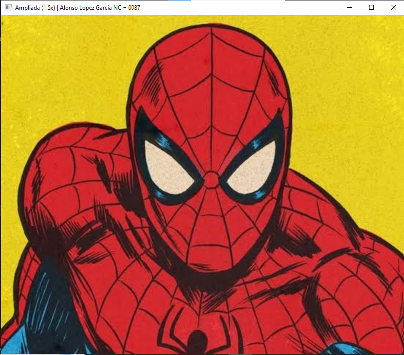

## 8. ROTACIÓN DE IMÁGENES
### Imagen rotada 

## 9. VOLTEO / ESPEJO DE IMÁGENES (FLIPPING)
### Imagen volteada horizontalmente 

### Imagen volteada verticalmente 

### Imagen volteada vertical y horizontalmente 

## 10. GUARDADO DE RESULTADOS Y LIMPIEZA
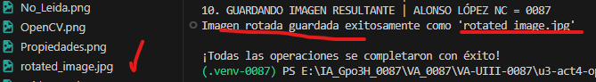